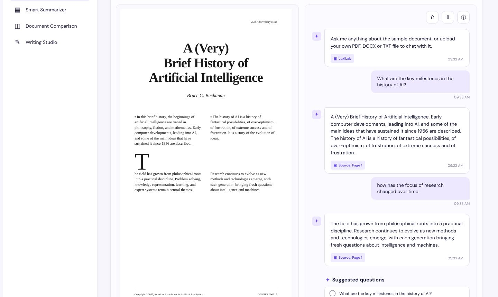
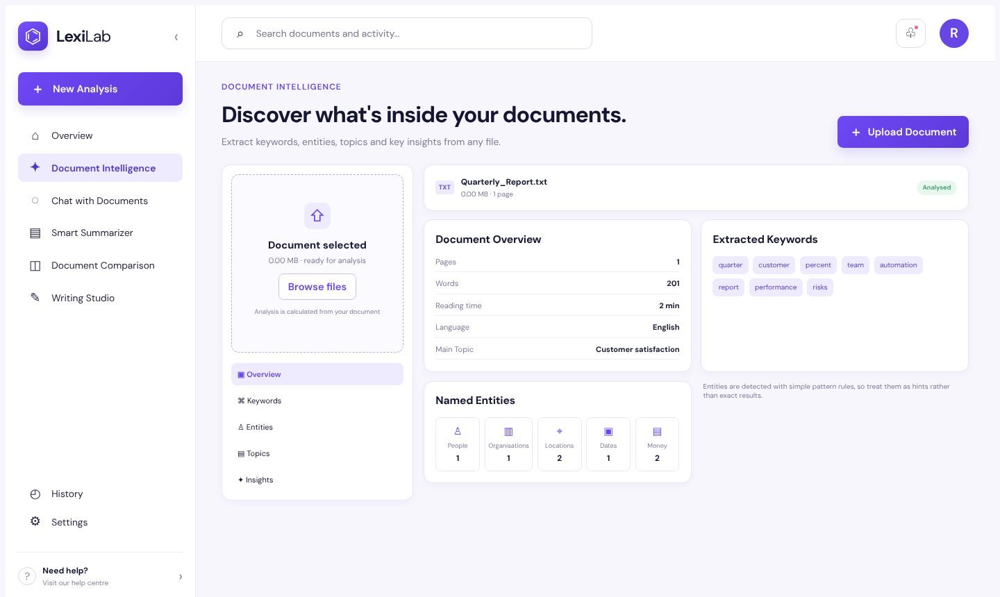
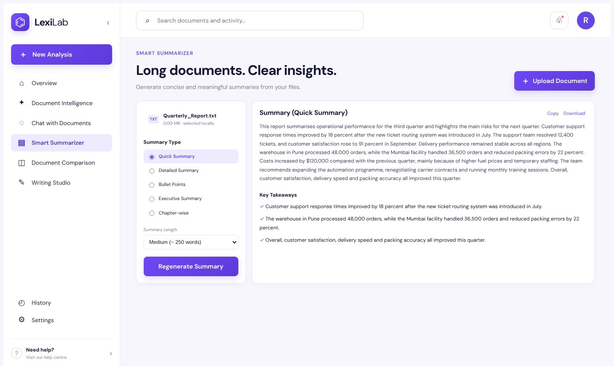
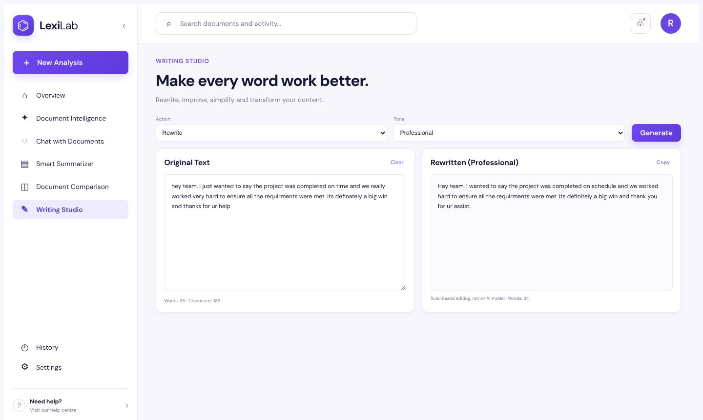
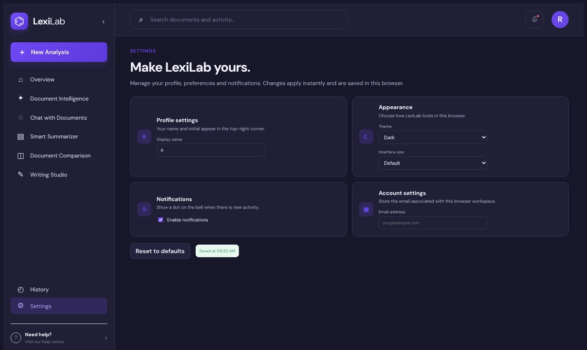
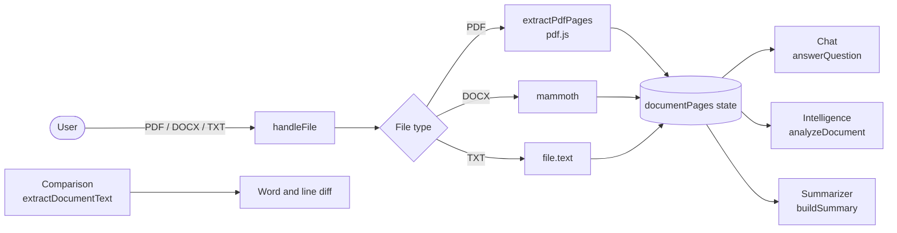
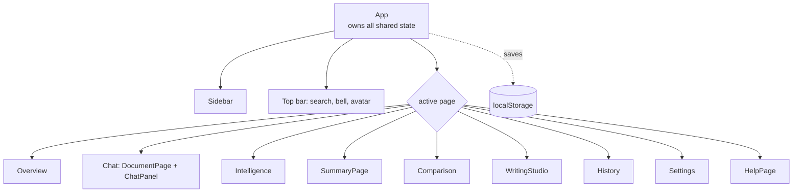

# LexiLab — Document Intelligence Workspace

LexiLab is a browser-based workspace for understanding documents. Open a PDF, Word (`.docx`) or text file and you can **chat with it**, **analyse it**, **summarise it**, **compare it with another version**, and **clean up your own writing** — all without creating an account, installing anything or sending your file to a server.

**Live demo:** https://riddhisc.github.io/TextUtils/

> **How it works in one sentence:** LexiLab reads the text of your document inside your browser, then ranks and picks the sentences that matter. Everything you see is taken from your own document. It does not use a generative AI model, so it never invents text.



---

## Table of contents

1. [Features](#features)
2. [Screenshots](#screenshots)
3. [Use cases](#use-cases)
4. [How each feature works](#how-each-feature-works)
5. [Architecture](#architecture)
6. [Tech stack](#tech-stack)
7. [Project structure](#project-structure)
8. [Getting started](#getting-started)
9. [Deployment](#deployment)
10. [Configuration](#configuration)
11. [Privacy and data](#privacy-and-data)
12. [Known limitations](#known-limitations)
13. [Troubleshooting](#troubleshooting)
14. [Roadmap](#roadmap)

---

## Features

| Page | What it does |
| --- | --- |
| **Overview** | Home screen with counters (documents uploaded, actions, summaries, comparisons), quick-action shortcuts, recent documents and recent activity. |
| **Chat with Documents** | Ask questions in plain words. Answers are the best-matching sentences from your file, each tagged with the page it came from (click the tag to jump to that page). Page-by-page viewer with page arrows and 50–200% zoom. Copy or download the conversation. |
| **Document Intelligence** | A quick profile of a file: pages, words, reading time, language, main topic, keywords and phrases, entities (people, organisations, locations, dates, money), topic bars and key insights. |
| **Smart Summarizer** | Five summary types (Quick, Detailed, Bullet Points, Executive, Chapter-wise) and three lengths (about 100, 250 or 500 words), plus Key Takeaways. Copy or download the result. |
| **Document Comparison** | Pick two files and see a similarity percentage, how many words were added and removed, and examples of new lines. Swap the two files with one click. |
| **Writing Studio** | Type or paste text, then Rewrite (Professional, Friendly or Concise), Simplify, Fix Grammar, or Convert to Bullet Points. |
| **History** | A searchable log of uploads, questions, summaries and comparisons. Remove single items or clear everything. |
| **Settings** | Display name, theme (Light, Dark, System), interface size (Compact to Extra large), notification dot and email. Applied instantly and remembered. |
| **Help centre** | An in-app guide to every page, who it is for and common fixes. Open it from **Need help?** in the sidebar. |

Supported files: **PDF** (with selectable text), **DOCX** and **TXT**, up to **25 MB**.

## Screenshots

| Document Intelligence | Smart Summarizer |
| --- | --- |
|  |  |

| Writing Studio | Dark theme (Settings) |
| --- | --- |
|  |  |

## Use cases

| Who | What they do with LexiLab |
| --- | --- |
| **Students** | Revise long readings, ask "where is X explained?", and pull out key points before an exam. |
| **Researchers** | Skim papers and reports, spot keywords, dates and figures, and compare two drafts of a paper. |
| **Business professionals** | Summarise reports and meeting notes, and check what changed between two versions of a document. |
| **Writers and editors** | Tidy grammar, simplify wording, switch tone, and see what was edited between drafts. |
| **Job seekers and learners** | Turn study material or interview-question PDFs into quick answers and short summaries. |
| **Anyone with long documents** | Decide whether a document is worth reading before spending time on it. |

---

## How each feature works

LexiLab uses classic text-processing techniques that run entirely in the browser. They are fast, predictable and easy to inspect, but they are rule-based and not a language model.

### Reading a document

`handleFile` checks the file type and size, then extracts the text into an array with **one entry per page**:

- **PDF** — [pdf.js](https://mozilla.github.io/pdf.js/) reads each page's text items (`extractPdfPages`).
- **DOCX** — [mammoth](https://github.com/mwilliamson/mammoth.js) extracts the raw text, which is split into pseudo-pages of about 3,000 characters.
- **TXT** — the file text is split the same way.

All features read from this shared `documentPages` array, so a file uploaded on one page is available on every other page.

### Chat with Documents — `answerQuestion`

1. Split every page into sentences.
2. Turn the question and each sentence into tokens: lowercase, remove common words, strip simple suffixes (`-s`, `-ed`, `-ing`).
3. Score each sentence by the words it shares with the question. Rarer words count more (an inverse-document-frequency weight: `log(1 + N / (1 + df))`).
4. Return the best three sentences in reading order, with their page numbers as source tags.
5. Broad questions ("what is this about?", "summarise") return the opening of the document. If nothing matches, it says so instead of guessing.

### Smart Summarizer — `buildSummary`

1. Split the document into sentences and count how often each meaningful word appears.
2. Score every sentence: `sum(word frequency / max frequency) / sqrt(number of words)`, with a small boost for the first sentence.
3. Keep the highest-scoring sentences until a word budget is reached. The budget is the chosen length (100 / 250 / 500 words) multiplied by the summary type (Quick ×0.5, Executive ×0.7, Bullet ×1, Chapter-wise ×1.2, Detailed ×1.6).
4. Put the chosen sentences back in reading order. Bullet Points formats them as a list. Chapter-wise groups pages (up to eight groups) and summarises each group.

### Document Intelligence — `analyzeDocument`

- **Keywords and phrases:** counts words of four or more letters (common words removed) and frequent two-word phrases.
- **Entities:** regular expressions and small word lists detect dates, money amounts, organisation names (names ending in words such as *University* or *Ltd*), places, and people (titles such as *Dr.*, names with a middle initial, and common first names).
- **Statistics:** pages, words, reading time (200 words per minute), sentence count, average sentence length, unique words.

### Document Comparison

Both files are reduced to sets of unique words. **Similarity = shared words ÷ all unique words.** Words only in the second file count as *added*, words only in the first as *removed*, and lines of the second file that do not appear in the first are listed as changed lines.

### Writing Studio — `transformText`

Fixed rule tables: contractions and expansions, plain-English and formal word swaps, filler-word removal, common typo fixes, spacing and punctuation clean-up, sentence capitalisation, and long-sentence splitting.

---

## Architecture

LexiLab is a **single-page React app with no backend**. There is no server, database or API. The browser does all the work, and GitHub Pages only serves static files.

### Data flow



### Component and state map



### Key design decisions

- **One owner of shared state.** `App` holds the selected file, extracted pages, history and settings, and passes them down as props. Pages that do not need a file (Writing Studio, Settings, Help) hold only their own state.
- **Pure helper functions.** `answerQuestion`, `buildSummary`, `analyzeDocument` and `transformText` take plain data and return plain data, so they are easy to test or replace (for example with a call to a language-model API).
- **Everything runs client-side.** Nothing about your documents leaves the browser.
- **Styling.** One hand-written stylesheet (`App.css`) with CSS variables. Dark mode is a `.theme-dark` class on the app shell. Interface size uses the CSS `zoom` property on the shell.
- **PDF worker.** pdf.js needs a worker file. It is bundled with the app, and if that fails it falls back to a copy on a CDN.

### Where data is stored

Only in the browser's `localStorage`:

| Key | Contents |
| --- | --- |
| `lexilab-settings` | Name, theme, interface size, notification toggle, email |
| `lexilab-history` | Up to 100 activity entries (names and actions, never file contents) |
| `lexilab-seen` | How many history items the bell has already shown |

---

## Tech stack

- [React](https://react.dev/) 18, built with [Create React App](https://create-react-app.dev/) (`react-scripts` 5)
- [pdfjs-dist](https://www.npmjs.com/package/pdfjs-dist) 3.11 for PDFs
- [mammoth](https://www.npmjs.com/package/mammoth) for `.docx`
- [gh-pages](https://www.npmjs.com/package/gh-pages) for deployment to GitHub Pages
- Plain CSS, with the *DM Sans* font from Google Fonts

## Project structure

```text
TextUtils/
├── public/
│   ├── index.html        # page shell, title and meta tags
│   ├── manifest.json     # PWA metadata
│   └── favicon, logos, robots.txt
├── src/
│   ├── index.js          # React entry point
│   ├── index.css         # base page styles
│   ├── App.js            # all components and helper functions
│   └── App.css           # all application styles (light and dark)
├── docs/screenshots/     # images used in this README
├── package.json          # scripts, dependencies, "homepage" for GitHub Pages
└── README.md
```

`public/index.html` still links Bootstrap 5 CSS from a CDN. It is left over from the original project template. The app's own styles do not use Bootstrap components, so it can be removed once you have checked the layout looks the same.

---

## Getting started

### Prerequisites

- [Node.js](https://nodejs.org/) 18 or newer (includes npm)
- [Git](https://git-scm.com/)

### Run it locally

```bash
git clone https://github.com/riddhisc/TextUtils.git
cd TextUtils
npm install
npm start
```

Open **http://localhost:3000/TextUtils**. The `/TextUtils` part is required because `homepage` in `package.json` tells the build to run under that path. If port 3000 is busy, accept the prompt to use another port (or start with `PORT=3001 npm start`; on Windows Command Prompt use `set PORT=3001 && npm start`).

### Scripts

| Command | What it does |
| --- | --- |
| `npm start` | Starts the development server with live reload |
| `npm run build` | Creates an optimised production build in `build/` |
| `npm run deploy` | Builds, then publishes `build/` to the `gh-pages` branch |

### Try it

1. Open **Chat with Documents**. A sample document is already loaded. Press a suggested question.
2. Upload your own PDF, DOCX or TXT with **New analysis**.
3. Switch to **Document Intelligence** or **Smart Summarizer**. The same file is used.

---

## Deployment

The site is hosted on **GitHub Pages** from the `gh-pages` branch.

```bash
git push origin master      # save your source code
npm run deploy              # build and publish the site
```

- `homepage` in `package.json` must be `https://<username>.github.io/<repository>`. For this project it is `https://riddhisc.github.io/TextUtils`.
- In the GitHub repository, **Settings → Pages** should be set to deploy from the `gh-pages` branch.
- After deploying, wait a minute or two and refresh with **Ctrl+F5**. Browsers cache the old version.

## Configuration

| What | Where |
| --- | --- |
| Hosting path | `homepage` in `package.json` |
| Maximum file size (25 MB) and allowed types | `handleFile` in `src/App.js` |
| Summary lengths and type multipliers | `buildSummary` in `src/App.js` |
| Interface size scales | `SIZE_SCALE` in `src/App.js` |
| Colours and spacing | CSS variables at the top of `src/App.css` |
| PDF worker location | `PDF_WORKER_BUNDLED` and `PDF_WORKER_CDN` in `src/App.js` |

## Privacy and data

- Files are read **inside your browser** and are not uploaded anywhere. They are gone when you close or refresh the page.
- Settings and history are stored in this browser's `localStorage` only. They do not sync to other browsers or devices, and clearing site data removes them.
- The page loads the DM Sans font from Google Fonts, and (only if the bundled PDF worker fails to load) a PDF worker script from cdnjs.

## Known limitations

- **No AI model.** Answers and summaries are sentences picked from your document. LexiLab cannot paraphrase, answer "why" questions that the text does not state, or combine facts from distant sections.
- **No OCR.** Scanned PDFs (pictures of pages) have no text to read.
- **Unsupported formats.** Old `.doc` files, password-protected files and damaged files cannot be opened.
- **Entity and language detection** use simple rules. Language detection recognises English only.
- **Writing Studio** follows fixed rules. Always read the output before using it.
- **Desktop first.** Below about 650 px wide the sidebar is hidden, so navigation on small phones is limited.
- **No automated tests yet.**

## Troubleshooting

| Problem | What to try |
| --- | --- |
| *"We could not read this document in the browser"* | The message includes the reason. Common causes: scanned PDF, password-protected file or damaged file. Export it again or save it as `.docx` / `.txt`. Open the browser console (F12) for details. |
| `localhost:3000/TextUtils` shows a 404 page | Another app is using port 3000. Start LexiLab on a different port, for example `PORT=3001 npm start`. |
| Blank page after deploying | `homepage` in `package.json` does not match the repository name. Fix it, then run `npm run deploy` again. |
| Old version still showing after deploy | Wait a minute, then hard-refresh with Ctrl+F5. |
| Text is too small or too big | Settings → Interface size. |
| `git push` rejected | Run `git pull origin master`, resolve any conflicts, and push again. |

## Roadmap

Ideas for future work:

- Optional language-model backend (a small serverless function that keeps the API key off the client) for true generative answers and summaries
- OCR for scanned PDFs
- Split `App.js` into one file per component, and add unit tests for the helper functions
- A mobile navigation menu
- Export summaries and comparisons as PDF or DOCX
- Highlight matching sentences directly in the PDF viewer

---

Built by [@riddhisc](https://github.com/riddhisc).
